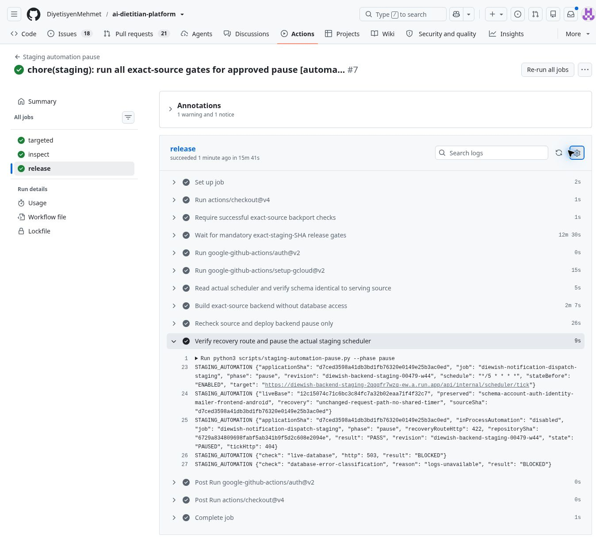

# APP-STAGING-AUTOMATION-PAUSE-A1 — teslim raporu

**Duraklatma: PASS. Canlı işlev kabulü: BLOCKED. Tamamlanma: %95.**

Gerçek staging Cloud Scheduler görevi duraklatıldı; sunucu içindeki otomatik bildirim gönderimi ve günlük/haftalık/aylık Koç işleri kapalı. Canlı veritabanı 503 verdiğinden tüm işlevlerin canlı kabulü tamamlanmış sayılmıyor.

## Gerçek ortam kanıtı

- Proje: `project-a2e260c1-839d-4f1d-b90`; bölge: `europe-west1`.
- Görev: `diewish-notification-dispatch-staging`; takvim korunuyor: `*/5 * * * *`; durum **PAUSED**.
- İlk geri okuma: `2026-10-20T10:35:10.2522295Z`.
- Son salt okunur kontrol: `2026-10-20T10:38:59.6318975Z`; görev yine **PAUSED**, sunucu yine `00479-w44`. Test/build/yayın tekrarlanmadı.
- [Son salt okunur kontrol](https://github.com/DiyetisyenMehmet/ai-dietitian-platform/actions/runs/39406894114/job/118583012643).
- Sunucu sürümü: `diewish-backend-staging-00479-w44`; trafiğin %100'ü.
- Uygulama içi otomasyon: `disabled`; dış `/tick`: HTTP **404**.
- Korunan hesap kurtarma yoluna eksik gövdeyle istek: HTTP **422**. Bu, gerçek e-posta teslimatının kanıtı değildir.
- Canlı veritabanı hazır olma kontrolü: HTTP **503 / BLOCKED**. Hata günlükleri okunamadı; kota nedenini bu çalışmada bağımsız doğrulama yetkisi yoktu.
- [Başarılı yayın ve gerçek PAUSED kaydı](https://github.com/DiyetisyenMehmet/ai-dietitian-platform/actions/runs/39406894114/job/118575664082).
- Cloud Build kimliği: `5a9573c0-5155-447a-902b-78b4203db268`.

## Kod kimlikleri

| Kaynak | HEAD (kod sürümü) | TREE (dosya bütünü) |
| --- | --- | --- |
| Güncel staging deposu | `6729a834809698fabf5ab341b9f5d2c608e2094e` | `b0d832d28e8b84955757d6dc51be2be6b588d871` |
| Yayındaki dar uyarlama | `d7ced3598a41db3bd1fb76320e0149e25b3ac0ed` | `7ac866992d661fb533b4e85e9a7615c5b0b7536d` |

- [PR #79](https://github.com/DiyetisyenMehmet/ai-dietitian-platform/pull/79): güncel staging kodunda otomasyon koruması ve istek temelli güvenli kurtarma ayrımı. Staging'e birleştirildi.
- [PR #80](https://github.com/DiyetisyenMehmet/ai-dietitian-platform/pull/80): yalnız çalışan sürüme uygun dar yayının güvenli yürütülmesi. Staging'e birleştirildi.
- İlk gerçek kontrol, çalışan kodun `12c15074c71c6bc3c84fc7a32b02eaa71f4f32c7` olduğunu ve staging'de beş daha yeni veritabanı göçü beklediğini buldu. İlk yayın, build/deploy/pause işleminden önce engellendi.
- Bu yüzden diğer bekleyen özellikler yayımlanmadan, çalışan sürüme yalnız küçük duraklatma koruması uyarlandı. Şema/göçler, hesap, kimlik doğrulama, kimlik bağlama, e-posta taşıyıcısı, Web ve Android dosyaları çalışan kaynakla aynı kaldı.

## Davranış ve sınırlar

Staging'de `STAGING_AUTOMATION_ENABLED=false` kapalı varsayılandır. Zamanlayıcı başlangıcı, günlük/haftalık/aylık toplu işler, doğrudan bildirim gönderimi ve dış `/tick` ilk sorgudan önce durur. Başlangıçtaki gereksiz `SELECT 1` de kapalı modda çalışmaz. Bildirim ve tercih kayıtları silinmedi.

Sonraki olağan staging yayınları kapalı bayrağı açıkça yazar; görevi oluşturmaz, sürdürmez veya zorla çalıştırmaz. Bildirim Merkezi, mevcut bildirimleri okuma, tercihler ve okundu işaretleri ile kullanıcının başlattığı Koç yolları korunur.

Çalışan eski sürümün şifre sıfırlaması zaten kullanıcı isteği içindedir; sonradan eklenen ortak kuyruk/zamanlayıcı henüz bu sürümde yoktu. Bu yol aynen korundu. Eski e-posta taşıyıcısında gerçek üretim SMTP gönderimi bağlı değildir; bu önceden var olan engel çözülmüş gösterilmiyor. Yeni staging kodundaki kalıcı kuyruk ise PR #79 ile Google kimliğiyle doğrulanan ayrı istek üzerinden çalışır; boşta 30 saniyelik sorgulama yapmaz. Tek kullanımlık bağlantı, sahiplik, zaman aşımı, sınırlı yeniden deneme ve yanıt gizliliği korunur.

## Test sonuçları

| Kontrol | Sonuç | Kanıt / sınırlama |
| --- | --- | --- |
| Güncel staging otomasyon/kurtarma koruması | PASS | 17 API/veritabanı/otomasyon + 1 manuel Koç + 11 çevrimdışı yayın koruması = 29 test |
| Çalışan sürüm uyarlaması | PASS | 5 duraklatma/kurtarma/manuel Koç + 2 seçilmiş Bildirim Merkezi/tercih testi = 7 test; 14 ilgisiz test filtreyle dışarıda |
| Gerçek dış görev | PASS | PAUSED geri okundu |
| Gerçek uygulama içi otomasyon | PASS | Onaylı kaynak, kapalı bayrak, %100 yeni sürüm, /tick 404 |
| Bildirim Merkezi, tercihler, okundu durumu | PASS / BLOCKED | Ayrı test veritabanında başarılı; canlı DB 503 yüzünden canlı işlev kontrolü engelli |
| Manuel Koç | PASS / BLOCKED | Yapay sağlayıcıyla başarılı; canlı DB 503 yüzünden canlı kullanım doğrulaması engelli |
| Hesap kurtarma | PASS / BLOCKED | Korunan/yeni akış testleri başarılı; canlı DB 503 ve eski gerçek SMTP eksikliği yüzünden gerçek teslimat kanıtlanmadı |
| Sonraki yayınların kapalı kalması | PASS | Yayın yapılandırması ve çevrimdışı koruma testleri |
| Güvenli yeniden açma | Prosedür hazır | Ayrı yönetici onayı ve QA gerekli; bu görevde yeniden açılmadı |

- [Güncel hedefli testler ve yayın](https://github.com/DiyetisyenMehmet/ai-dietitian-platform/actions/runs/39406894114).
- [Çalışan kaynak uyarlamasının yedi testi](https://github.com/DiyetisyenMehmet/ai-dietitian-platform/actions/runs/39406127287).
- Zorunlu yayın kontrolleri: Hardening CI `39406894599`, Staging Config CI `39406894195`, Notification preferences platform checks `39406894141` — başarılı.
- Gerçek test bildirimi/e-postası/AI isteği üretilmedi; test verileri ayrı PostgreSQL'deydi.

## Mobil cihazlar

Android'deki yerel su, hareket, uyku ve öğün hatırlatmaları sunucudan bağımsızdır. Önceden kurulmuş alarmlar ve yeniden başlatmada geri yüklenen kayıtlar uzaktan kaldırılmadı. Cihazlara erişilmediği için fiilî kurulu alarm envanteri doğrulanamadı; tüm cihaz bildirimlerinin susturulduğu iddia edilmez.

## Yeniden etkinleştirme

1. Eski, teslim edilmemiş bildirim kuyruğunu ve yeniden deneme durumlarını inceleyin; eski kayıtları körlemesine toplu göndermeyin veya silmeyin.
2. Güncel tam staging kaynağı, veritabanı göçleri, gerçek e-posta sağlayıcısı ve hesap kurtarma için ayrı kabul kontrollerini tamamlayın.
3. Ayrı yönetici onayıyla yayın yapılandırmasındaki zorunlu kapalı durumu değiştirin ve açık bayrağı kontrollü etkinleştirin.
4. Doğrulanan staging görevini bilinçli olarak sürdürün ve ilk gönderimleri izleyin. Olağan yayın veya tek bayrak değişikliği dış görevi kendiliğinden açmaz.

Neon'un kendiliğinden uykuya geçme süresi değiştirilmedi. Bu işlem mevcut aylık kota aşımını sıfırlamaz. Production/main, yeni ücretli servis, IAM yetki değişikliği, APK, Web/Android yayını ve kullanıcı verisi silme işlemi yok.

