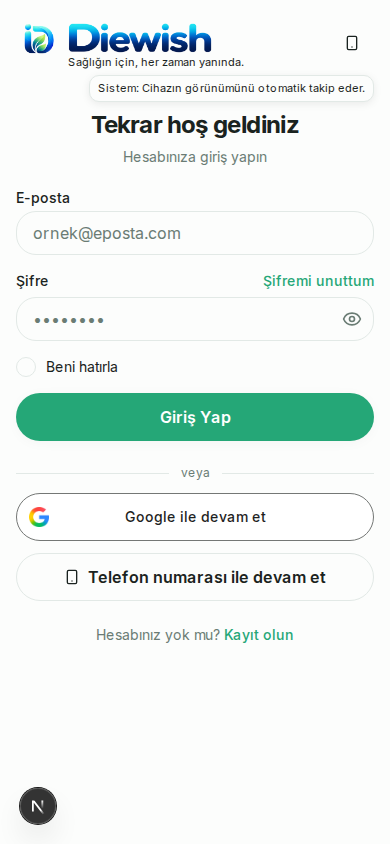
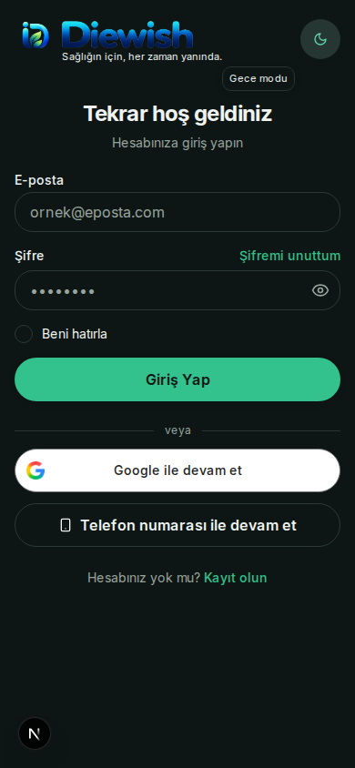

# G2 / Devam 3 — görünüm kontrolü ve açılış

30 Ekim 2026, 🛠️ Uygulama Çalışanı 9. PR #124, #120.

Durum: **PARTIAL (kısmi), tamamlanma %90.** Kod ve hedefli yerel doğrulamalar hazır; fiziksel Android ilk kare/hız kabulü yapılmadı. Yayında/cihazda çözüldü iddiası yok.

Başlangıç PR HEAD (son kayıt): `952bdbad69ebf1cb748814a862010482f3146713`; TREE (kod ağacı): `361651af1e8e8be03a4bf502691aeb8755b20dd1`. Kontrol edilen güncel staging: `51ba9fcef7cff7627792303584448c91b05d70dd`. Staging'in G1/öğün değişiklikleri tema düğmesi, tema sağlayıcısı, Android ana ekranı veya değiştirilen testlerle çakışmıyor; bu çalışmaya taşınmadı, değiştirilmedi. Teslim SHA/TREE ve son CI (otomatik kontrol) durumları PR/#120 kapanış yorumundadır.

## Uygulanan davranış

- Mevcut `ThemeToggle`, aynı `next-themes` ve aynı `theme` tercihi: Gündüz → Gece → Sistem → Gündüz. Seçim penceresi kaldırıldı. Admin dalındaki eski iki durumlu düğme korundu.
- Sistem simgesi yerel ve düşük ayrıntılı cihaz ipuçlarıyla telefon/tablet/monitör olur; belirsiz cihaz için monitör, kaba dokunmalı cihazda kısa kenara göre telefon/tablet varsayımı. Ağ çağrısı, cihaz kimliği veya kayıt yok.
- `diewish:appearance-hints:v1` yalnız üç sınırlı yerel sayaç içerir. Her modun ilk üç kısa seçiminde kendi etiketi 2000 ms gösterilir; dördüncü seçimde gösterilmez. Yeniden açma, sayfa veya sistem teması değişimi sayacı artırmaz. Bozuk/erişilemeyen sayaç depolaması tema seçimini engellemez; depolama kapalıysa açılışlar arası sayaç kalıcılığı garanti edilemez.
- Etiket sol tarafta ve yerleşimi itmeden görünür; 430 px ve altında logo satırının altındaki boşluğa yerleşir. Uzun açıklamayla üst üste binmez. Açıklama fareyle bekleme, klavye odağı ve 500 ms dokunma basışında görünür; erişilebilir açıklama etiketi her zaman mevcuttur. Fare açıklamasına geçiş ve Escape desteklidir. Hareket/iptal, basış sonu ve bileşen temizliği zamanlayıcıları sonlandırır; uzun basışın uyumluluk tıklaması mod veya sayaç değiştirmez. Klavye/yardımcı teknoloji tıklaması engellenmez.

## Açılışta kanıtlanan fark ve dar düzeltme

Android yüzeyleri `#FFFFFF` / `#0F1412`, değiştirilmeyen web arka planı ise `hsl(150 20% 99%)` / `hsl(165 25% 7%)` idi. Web'in hesaplanan sRGB renkleri tarayıcıda `#FCFDFC` / `#0D1614` doğrulandı. Yalnız Android pencere/açılış kaplaması/WebView/inset yüzeyleri mevcut web renklerine eşleştirildi. Logo/ikon dosyası, oranı, katmanı ve renkleri değiştirilmedi.

Kayıtlı manuel görünümün `isLightTheme` niteliği ilk WebView oluşturulmadan önce uygulanıyor. Sistem moduna dönüşte önceki manuel temadan kalmış web medya sorgusu rengi yerine cihaz yapılandırması esas alınıyor. Mevcut origin (kaynak adres) doğrulaması, gerçek çizim kapısı ve aynı WebView korunuyor. Yeni açılış zamanlayıcısı, ağ isteği, ikinci logo veya WebView yeniden yüklemesi eklenmedi.

[Android tema belgesi](https://developer.android.com/develop/ui/views/theming/darktheme), Android 12+ için uygulamaya özel gece moduyla sistem açılışını eşleştirmeyi önerir. [WebView belgesi](https://developer.android.com/develop/ui/views/layout/webapps/dark-theme), `prefers-color-scheme` değerinin `isLightTheme` niteliğine bağlı olduğunu açıklar. Düzeltme bu mevcut davranışı kullanır; otomatik karartma açılmadı.

## Hedefli kanıt

- **14 farklı yeni Chromium senaryosu başarılı:** kısa döngü; üç ayrı sayaç × ilk üç/4. seçim × tam 1999/2000 ms sınırı; kalıcılık/yeniden yükleme/sayfa değişimi; daima erişilebilir fare/klavye açıklaması; telefon/tablet/bilgisayar simgeleri ve gerçek Chromium dokunma olaylarıyla uzun basma/sonraki kısa dokunma; dört ilk açılış eşleşmesi; canlı Sistem değişimi; bozuk/kapalı depolama; 320/390 px'te her üç etiketin logo, başlık ve ekran sınırlarıyla çakışmaması. İlk 12 geçti; son yönlendirme ve görsel düzenlemelerden sonra yalnız etkilenen 4 açılış, 4 yardım ve 2 etiket senaryosu tekrar doğrulandı. Eski 48/6/23 paketi yeniden başlatılmadı.
- **4 hedefli Android test metodu başarılı, 0 hata/atlama:** `fourColdStartCombinationsMatchSavedChoiceBeforeFirstWebLoad`, `returningFromManualToSystemRejectsStaleManualMediaColor`, `savedLightAppThemeRecolorsTheCoverWithoutRemovingItsArtwork`, `darkLaunchUsesTheExistingDarkSurface`. İlk test dört cihaz/manuel görünüm eşleşmesini, ilk yüklemedeki niteliği ve pencere/kaplama renklerini denetler. JUnit çıktısı toplam 4 sonuç içerir; SDK anotasyonlarını ayrıca koşulmuş cihaz sonuçları gibi saymıyoruz.
- Admin için yalnız ilgili mevcut davranış birim kontrolü: 1 başarılı.
- Hedefli ESLint, TypeScript, biçim ve `git diff --check`: başarılı. Eski testlerin seçim eylemleri yeni döngüye uyarlandı; diğer doğrulamaları korunuyor.
- Yeni tam üretim derlemesi yerelde tekrarlanmadı. Önceki kabul edilmiş derleme yeni SHA için yeni derleme sonucu sayılmaz; yeni PR CI sonuçları kapanış yorumunda ayrıdır.
- Başlangıç araç kurulumu engelleri ürün testi sayılmadı: varsayılan tarayıcı indirmesi/eksik dosya, eksik yerel JDK/SDK yerleşimi ve yeni JDK'nın CA deposu. Resmî Chrome headless shell (ekransız tarayıcı), JDK/SDK ve ortamın mevcut güvenilir CA deposuyla testler tamamlandı; TLS doğrulaması kapatılmadı. İlk yeni XML yorum sözdizimi hatası ve etiket çakışması hedefli kontrollerle yakalanıp düzeltildi; süre artırma/atlama yok.

Komut kapsamları:

```text
npx playwright test --config=playwright.system-theme.config.ts e2e/appearance-control.spec.ts
# Son değişikliklerden sonra yalnız ilgili cold startup / hover / system icon / short label senaryoları.
:app:testDebugUnitTest --tests <yukarıdaki dört metot>
node --test --test-name-pattern=Admin tests/system-theme.test.cjs
npx eslint <değişen TS/TSX test ve bileşenleri>
npx tsc --noEmit
```

Sentetik API yanıtlarıyla izole tarayıcı kullanıldı; gerçek hesap veya ortak veritabanı kullanılmadı. Geliştirme sunucusu ölçümlerinde yeniden açılan dört giriş sayfasının DOM hazır olma örnekleri yaklaşık 202–423 ms idi; testin görsel hazır kontrolü yaklaşık 1.7–2.0 sn'de gözlendi. Bunlar Android soğuk açılış kıyaslaması veya performans kabulü değildir.

## Dört durum ve kalan kabul

| Telefon | Diewish tercihi | Web ilk görünür kare/yeniden açma | Android pencere/kaplama birim kanıtı | Fiziksel telefon |
| --- | --- | --- | --- | --- |
| Gece | Gündüz | Başarılı | Başarılı | Yapılmadı |
| Gece | Gece | Başarılı | Başarılı | Yapılmadı |
| Gündüz | Gündüz | Başarılı | Başarılı | Yapılmadı |
| Gündüz | Gece | Başarılı | Başarılı | Yapılmadı |

Sistem modunun canlı cihaz görünümü değişimini takip etmesi ve manuel tercihin buna rağmen korunması tarayıcıda ayrıca doğrulandı.

**Açık sınır:** Activity (Android ekranı) çalışmadan önceki işletim sistemi penceresi Java düzeltmesiyle geriye dönük boyanamaz. Android 8–11'de karşıt manuel tercihle bu en ilk sistem karesinin eşleşmesi ve ilk yükseltmede Android'e henüz aynalanmamış web tercihi bu görevde garanti edilemedi. Android 12+ için mevcut uygulamaya özel gece modu kaydı korunuyor; gerçek OS/WebView davranışı fiziksel telefonda kabul bekliyor. Web/rengi eşleşmiş birim testi bu sınırı kapatmaz. Fiziksel kayıtta ilk logo → giriş, sistem çubukları, ek logo olmaması ve açılış süresi ayrıca değerlendirilmeli.

## Tarayıcı ekran kanıtları

Gerçek fiziksel telefon görüntüleri değildir; yeni kodun Chromium bileşen kayıtlarıdır. Sol alttaki geliştirme göstergesi üretim arayüzü değildir.





Birleştirme, APK üretimi, yayın, ortak DB, production/main veya Admin ürün değişikliği yapılmadı. APK üretebilen otomatik akış yeniden tetiklenirse paketleme başlamadan iptal edilmesi gerekir; iptal edilen kontrol başarılı sayılmaz. Son CI durumu GitHub teslim yorumunda verilir.
